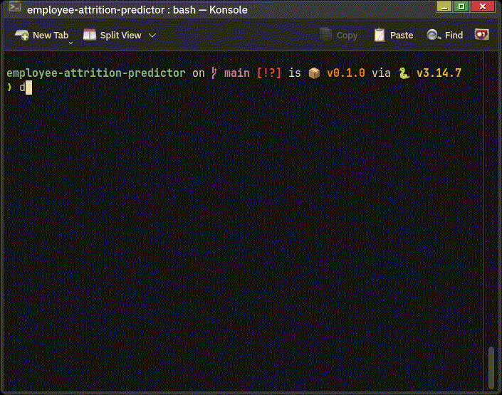
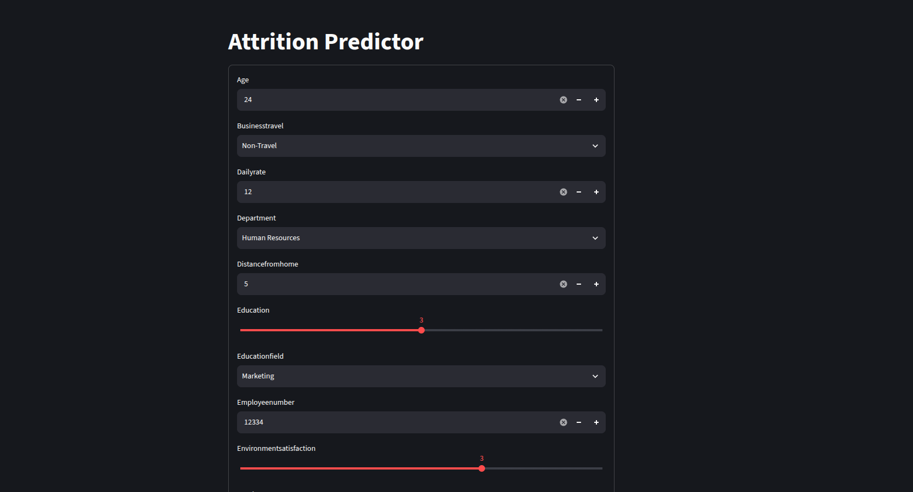
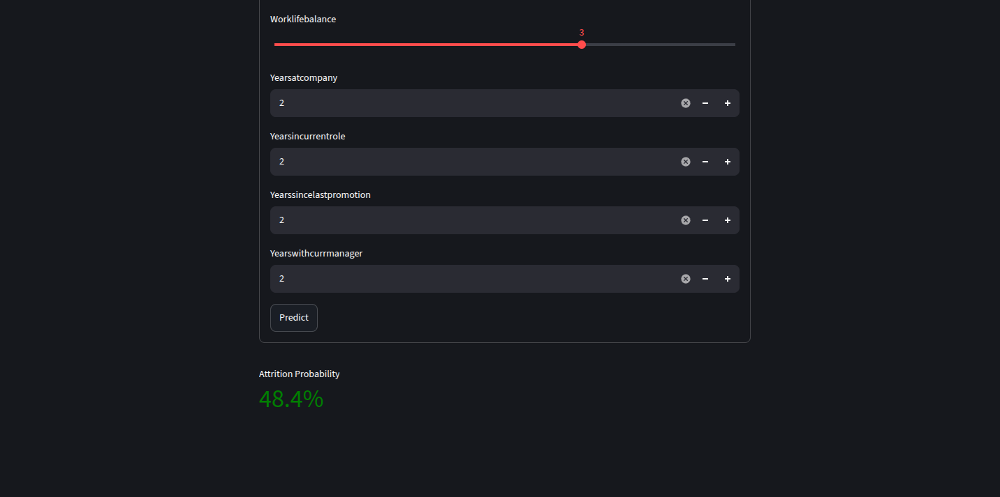

# Employee Attrition Predictor

[](https://github.com/dylanhrojas/employee-attrition-predictor/actions/workflows/ci.yml)

Binary classifier that estimates the probability that an employee leaves the company, served through a FastAPI endpoint and a Streamlit form.

The dataset is the [IBM HR Analytics Employee Attrition & Performance](https://www.kaggle.com/datasets/pavansubhasht/ibm-hr-analytics-attrition-dataset) dataset from Kaggle (1,470 employees, 35 columns). It is synthetic, so the results say more about the modeling process than a real business case. The dataset is licensed under the [Database Contents License (DbCL) 1.0](https://opendatacommons.org/licenses/dbcl/1-0/).

## Demo

Running `docker compose up --build` and using the Streamlit form:



| Form | Prediction |
|---|---|
|  |  |

There is no public deployment. The UI is an auto-generated form of ~30 fields that returns a single probability, and it runs on a generic dataset (IBM HR), so it is meant to be run locally with Docker Compose (see [Running it](#running-it)).

## Results

Logistic Regression (Params: `C=0.1`, `class_weight="balanced"`) showed better results in cross-validation (comparing train vs validation). XGBClassifier and Random Forest couldn't reach the Logistic Regression metrics even after hyperparameter tuning.

Metrics on the held-out test set (294 employees, 47 of whom left):

| Metric | Value |
|---|---|
| Recall | 0.660 |
| F2 | 0.568 |
| ROC AUC | 0.808 |
| Average precision | 0.573 |
| Balanced accuracy | 0.721 |
| F1 | 0.470 |

Recall and F2 were important for this classification problem because minimizing false negatives is the priority. Not detecting employees who leave is more expensive than wrongly flagging employees as likely to leave.

Due to dataset size (1,470 rows), class-imbalance parameters (class weights) were used as defaults for classifiers since there are only 47 positive cases in the test split. Logistic Regression had the smallest drop in recall between train and test.

## Approach

### Data

A stratified 80/20 split is used, since attrition is rare in the dataset. These features were dropped because they didn't offer importance to the models:
- `EmployeeCount` (Constant)
- `StandardHours` (Constant)
- `Over18` (Constant)
- `EmployeeNumber` (ID)

These features were converted to binary:
- `Gender` -> `IsMale` (Most employees are male in this dataset)
- `OverTime`

### Preprocessing

A helper function `build_preprocessor` is used for retrieving an unfitted ColumnTransformer for training and testing. This was required since this dataset has ordinal, numerical and nominal variables and OrdinalEncoder, StandardScaler and OneHotEncoder are used respectively.

### Models compared

5-fold stratified CV on the training split, class weights in every model.

| Model | Recall | F2 | ROC AUC | Train F2 |
|---|---|---|---|---|
| Dummy (stratified) | 0.158 | 0.160 | 0.505 | |
| Logistic regression (tuned) | 0.763 | 0.639 | 0.828 | 0.675 |
| XGBoost (tuned) | 0.458 | 0.485 | 0.804 | 0.953 |
| Random forest (tuned) | 0.579 | 0.534 | 0.782 | 0.733 |

All values are CV means on the validation folds.

A GridSearchCV was used with Logistic Regression baseline for hyperparameters `C` and `class_weight`. For XGBClassifier and RandomForest, firstly, a RandomizedSearchCV was used due to computational cost and then a GridSearchCV for hyperparameters at the edge of the search space, with other hyperparameters fixed.

Metrics favored the simpler model (Logistic Regression). Complex models (XGBClassifier and Random Forest) showed extreme overfitting (baseline) and, even with hard regularization, they couldn't outperform Logistic Regression results.

### What the model relies on

- Higher risk: `OverTime` (+1.24), frequent `BusinessTravel` (+0.68), Laboratory Technician (+0.68), `YearsSinceLastPromotion` (+0.42), `NumCompaniesWorked` (+0.38), being single (+0.37).
- Lower risk: `TotalWorkingYears` (-0.38), `YearsWithCurrManager` (-0.37), `EnvironmentSatisfaction` (-0.36), `JobSatisfaction` (-0.34).

Weights from the model showed reasonable links to attrition: frequent travel, overtime work, a large number of previous employers, etc.  
Also, general employee and job satisfaction (internal survey), familiarity with the current manager and seniority were associated with lower attrition probability.

## Limitations

- The dataset is generic (IBM HR), synthetic and small, so it does not reflect any specific company, and there is no time dimension, so there is no way to check how the model behaves on new employees over time.
- The API uses a fixed 0.5 probability cutoff.
- The model uses `Gender`, `Age` and `MaritalStatus`. A model like this should not be used to make decisions about individual employees; at most it could help look at patterns such as overtime or time without promotion.
- Feature engineering was not explored. The models use the original columns only.
- The Streamlit form returns only the probability, not an explanation of the individual prediction.

## Project structure

```
├── api/                 FastAPI app and Dockerfile
├── ui/                  Streamlit app and Dockerfile
├── schemas/employee.py  Pydantic models shared by the API and the UI
├── src/
│   ├── data_processor.py   Cleaning, splitting, preprocessor
│   └── model_trainer.py    Trains the final pipeline and saves it to models/
├── tests/               pytest tests for preprocessing and the API
├── .github/workflows/   CI workflow (ci.yml)
├── notebooks/
│   ├── 01_eda.ipynb
│   └── 02_modeling.ipynb
├── data/raw/            Original CSV
├── examples/            GIF and screenshots used in this README
├── LICENSE              MIT license for the code
└── docker-compose.yml
```

## Running it

### With Docker

```bash
docker compose up --build
```

The API image trains the model while it builds. Then:

- Streamlit app: http://localhost:8501
- API docs (Swagger): http://localhost:8000/docs

### Without Docker

Requires Python 3.14 or newer.

```bash
python -m venv .venv
source .venv/bin/activate
pip install ".[api,ui]"

python src/model_trainer.py          # creates models/attrition_pipeline.joblib
uvicorn api.main:app --port 8000     # terminal 1
streamlit run ui/app.py              # terminal 2
```

To run the notebooks, install `".[dev]"` instead. To run the tests, see [Tests](#tests).

### Example request

```bash
curl -X POST http://localhost:8000/predict \
  -H "Content-Type: application/json" \
  -d '{"Age": 41, "BusinessTravel": "Travel_Rarely", "DailyRate": 1102, "Department": "Sales", "DistanceFromHome": 1, "Education": 2, "EducationField": "Life Sciences", "EmployeeNumber": 1, "EnvironmentSatisfaction": 2, "Gender": "Female", "HourlyRate": 94, "JobInvolvement": 3, "JobLevel": 2, "JobRole": "Sales Executive", "JobSatisfaction": 4, "MaritalStatus": "Single", "MonthlyIncome": 5993, "MonthlyRate": 19479, "NumCompaniesWorked": 8, "Over18": "Y", "OverTime": "Yes", "PercentSalaryHike": 11, "PerformanceRating": 3, "RelationshipSatisfaction": 1, "StockOptionLevel": 1, "TotalWorkingYears": 8, "TrainingTimesLastYear": 0, "WorkLifeBalance": 1, "YearsAtCompany": 6, "YearsInCurrentRole": 4, "YearsSinceLastPromotion": 0, "YearsWithCurrManager": 5}'
```

The API requires `EmployeeNumber` and `Over18`, but both are dropped before prediction and do not affect the result.

The response has the form `{"prediction": true, "probability": 0.xx}`.

## Tests

```bash
pip install ".[api,test]"
python src/model_trainer.py   # the API tests need the trained model
pytest
```

`models/` is in `.gitignore` and the API loads the model on import, so the model has to be trained before running the tests.

- `tests/test_data_processor.py`: preprocessing (constant columns and ID dropped, `Gender` converted to `IsMale`, `OverTime` as boolean).
- `tests/test_api.py`: the `/predict` endpoint, with a valid request, an out-of-range value and a missing field (the last two return 422 from Pydantic), plus default values.

## CI

A GitHub Actions workflow (`.github/workflows/ci.yml`) runs on every push to `main` and on every pull request, with two jobs:

- `test`: installs the dependencies, trains the model and runs `pytest` on Python 3.14.
- `docker`: runs only if `test` passes and builds the API and UI images with `docker compose build`. The API image also trains the model, so this works as an integration check.

## License

The code is released under the [MIT License](LICENSE). The dataset (`data/raw/HR-Employee-Attrition.csv`) is not covered by it: it is licensed under [DbCL 1.0](https://opendatacommons.org/licenses/dbcl/1-0/).
